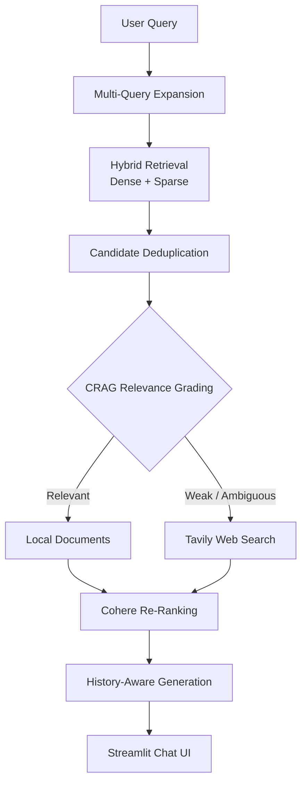

# 🚀 Corrective RAG Engine

> A production-style Retrieval-Augmented Generation (RAG) application featuring **Hybrid Search**, **Corrective RAG (CRAG)**, **Multi-Query Retrieval**, **Web Search Fallback**, **Cross-Encoder Re-Ranking**, and **Conversation Memory**.

<p align="center">

[](YOUR_STREAMLIT_LINK)
[](https://www.python.org/)
[](https://www.langchain.com/)
[](https://qdrant.tech/)
[](https://streamlit.io/)
[](LICENSE)

</p>

---

## 🌐 Live Demo

**👉 https://YOUR-STREAMLIT-APP.streamlit.app**

Upload a PDF, ask questions, and watch the retrieval pipeline automatically decide whether to answer from your documents or perform a live web search.

---

## ✨ Features

- 📄 Upload and chat with PDF documents
- 🔍 Hybrid Retrieval (Dense + Sparse/BM25)
- 🔄 Multi-Query Expansion for improved recall
- 🧠 Corrective RAG (CRAG) document grading
- 🌐 Tavily Web Search fallback when local context is insufficient
- 🎯 Cohere Cross-Encoder Re-ranking
- 💬 Conversation memory with automatic history trimming
- ⚡ Streamlit chat interface with source attribution

---



# 🖼 Demo

<p align="center">

</p>

---

# ⚙ Tech Stack

| Category | Technology |
|-----------|------------|
| Framework | LangChain (LCEL) |
| UI | Streamlit |
| Vector Database | Qdrant |
| Dense Embeddings | BAAI/bge-small-en-v1.5 |
| Sparse Retrieval | BM25 |
| LLM | Groq (Llama-3 / Mixtral) |
| Re-Ranking | Cohere rerank-v3.5 |
| Web Search | Tavily |
| PDF Loader | PyMuPDF |
| Language | Python |

---

# ⚡ Retrieval Pipeline

### 1. PDF Processing

- PyMuPDFLoader
- RecursiveCharacterTextSplitter
- Chunk Size: **800**
- Chunk Overlap: **100**

---

### 2. Hybrid Retrieval

Each user question is expanded into multiple search queries.

The retriever combines:

- Dense semantic embeddings
- Sparse BM25 retrieval

to improve recall compared to using either technique alone.

---

### 3. Corrective RAG (CRAG)

Retrieved documents are evaluated by an LLM.

If the retrieved context is:

- Relevant → continue
- Weak / Ambiguous → trigger Tavily Search

This prevents answering from poor-quality retrieval.

---

### 4. Web Search Fallback

When local documents are insufficient, the pipeline automatically retrieves fresh information using Tavily Search before generation.

---

### 5. Re-Ranking

Candidate passages are re-ordered using Cohere's Cross-Encoder model to maximize the quality of the final context sent to the LLM.

---

### 6. Conversation Memory

Chat history is maintained using LangChain message history.

Older messages are trimmed automatically to keep prompts within token limits.

---

# 📊 Configuration

| Parameter | Value |
|------------|------|
| Chunk Size | 800 |
| Chunk Overlap | 100 |
| Embedding Model | BAAI/bge-small-en-v1.5 |
| Retrieval | Hybrid Search |
| Retrieval Depth | Top-5 |
| Re-ranker | Cohere rerank-v3.5 |
| Memory | Trimmed Chat History |
| LLM | Groq |

---

# 📁 Project Structure

```text
corrective_rag_engine/

├── app.py
├── requirements.txt
├── README.md
├── .env.example
│
├── assets/
│   └── ss.png
│
├── chain/
│   └── final_chain.py
│
├── ingestion/
│   └── ingest.py
│
├── retrieval/
│   ├── context.py
│   ├── crag.py
│   ├── multiquery.py
│   └── rerank.py
│
└── config/
    ├── history.py
    ├── llm.py
    ├── models.py
    ├── prompt.py
    ├── vectordb.py
    └── websearch.py
```

---

# 🚀 Getting Started

## Clone Repository

```bash
git clone https://github.com/demondiablo2823-png/corrective_rag_engine.git

cd corrective_rag_engine
```

---

## Create Environment

```bash
python -m venv .venv

source .venv/bin/activate
```

Windows

```bash
.venv\Scripts\activate
```

---

## Install Dependencies

```bash
pip install -r requirements.txt
```

---

## Configure Environment Variables

Create a `.env` file.

```env
GROQ_API_KEY=

QDRANT_ENDPOINT=

QDRANT_API_KEY=

COHERE_API_KEY=

TAVILY_API_KEY=
```

---

## Run

```bash
streamlit run app.py
```

---

# 🔮 Future Improvements

- LangGraph workflow orchestration
- GraphRAG integration
- Local LLM support (Ollama/vLLM)
- Semantic response caching
- Docker deployment
- User authentication
- Multi-document collections

---

# 📚 References

- Corrective Retrieval-Augmented Generation (CRAG)
- LangChain LCEL
- Qdrant Documentation
- Cohere ReRank
- Tavily Search

---

# 📄 License

Released under the MIT License.