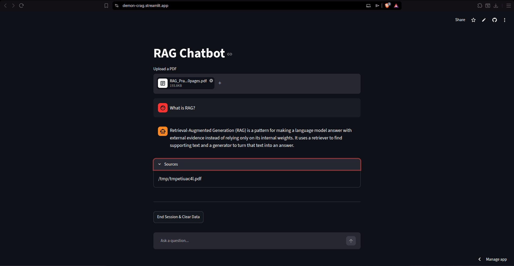

# Corrective RAG (CRAG) Engine with Hybrid Search & Dynamic Fallback

**Live Demo:** [demon-crag.streamli
[](https://www.langchain.com/)
[](https://streamlit.io/)
[](https://qdrant.tech/)
[](LICENSE)

A Retrieval-Augmented Generation (RAG) pipeline implementing **Multi-Query Expansion**, **Qdrant Dense + BM25 Hybrid Search**, **Corrective RAG (CRAG) Document Self-Grading**, **Tavily Web Search Fallback**, **Cohere v3.5 Re-Ranking**, and **Trimmed Conversation Memory**.

---

## 📌 Technical Summary

This repository implements a multi-stage retrieval and self-correction pipeline designed to maximize context quality and reduce model hallucination:

- **Document Processing**: PDF parsing via `PyMuPDFLoader` and recursive chunking (`chunk_size=800`, `chunk_overlap=100`).
- **Hybrid Vector Retrieval**: Qdrant VectorStore combining dense embeddings (`BAAI/bge-small-en-v1.5`) and sparse lexical search (`Qdrant/bm25`).
- **Multi-Query Synthesis**: Asynchronous LLM query generation producing 3 variations to increase candidate recall.
- **CRAG Relevance Grading**: Document evaluator LLM step scoring context relevance. Triggers real-time web search via Tavily when retrieved documents are insufficient.
- **Cross-Encoder Re-Ranking**: Cohere `rerank-v3.5` re-scoring candidates for optimal context density.
- **Memory Management**: LangChain `trim_messages` window strategy (400 tokens limit) preserving system context and conversation history.

---

## 🏗️ System Architecture

```
                          ┌──────────────────────────┐
                          │    User Input Query      │
                          └────────────┬─────────────┘
                                       │
                         ┌─────────────▼─────────────┐
                         │   Multi-Query Expansion   │
                         │    (3 Synthesized Queries) │
                         └─────────────┬─────────────┘
                                       │
                         ┌─────────────▼─────────────┐
                         │  Qdrant Vector Database   │
                         │  (Hybrid: BGE-Small +     │
                         │        FastEmbed BM25)    │
                         └─────────────┬─────────────┘
                                       │
                         ┌─────────────▼─────────────┐
                         │ Deduplicated Candidates   │
                         └─────────────┬─────────────┘
                                       │
                         ┌─────────────▼─────────────┐
                         │   CRAG Self-Grading Evaluator│
                         └──────┬──────────────┬─────┘
                                │              │
           (CORRECT / AMBIGUOUS)│              │(INCORRECT / AMBIGUOUS)
                                ▼              ▼
                    ┌──────────────┐        ┌────────────────┐
                    │ Document Pass│        │ Tavily Live    │
                    │  (Relevant)  │        │ Web Search     │
                    └──────┬───────┘        └───────┬────────┘
                           │                        │
                           └───────────┬────────────┘
                                       │
                         ┌─────────────▼─────────────┐
                         │   Cohere Rerank v3.5      │
                         │  (Cross-Encoder Ranking)  │
                         └─────────────┬─────────────┘
                                       │
                         ┌─────────────▼─────────────┐
                         │ History-Aware Trimmed Chain│
                         │   (Groq Llama-3 / Mixtral) │
                         └─────────────┬─────────────┘
                                       │
                         ┌─────────────▼─────────────┐
                         │ Streamlit Chat UI + Source │
                         │        Attribution        │
                         └───────────────────────────┘
```

---

## 🖼️ User Interface

rt demo GIF (`demo.gif`) into the `assets/` directory.*

---

## 📊 Pipeline Parameters & Benchmark Specs

| Component | Configuration / Specification |
| :--- | :--- |
| **Document Chunking** | Size: 800 characters, Overlap: 100 characters |
| **Dense Embedding Model** | `BAAI/bge-small-en-v1.5` (384 dimensions) |
| **Sparse Vector Model** | FastEmbed `Qdrant/bm25` |
| **Retrieval Depth** | Top-5 hybrid vector candidates per expanded query variation |
| **Re-Ranker Model** | Cohere `rerank-v3.5` (Top-N: 5) |
| **LLM Provider** | Groq (`llama3-70b-8192` / `mixtral-8x7b-32768`) |
| **Memory Window** | Max 400 token history buffer with system prompt preservation |

---

## 📂 Repository Structure

```
corrective_rag_engine/
├── app.py                   # Streamlit user interface & async orchestration
├── requirements.txt         # Project dependencies
├── .env.example             # Environment variable template
├── LICENSE                   # MIT License
├── README.md                 # Technical documentation
├── assets/                  # Interface screenshots and demo media
│   └── README.md
├── chain/
│   └── final_chain.py       # LangChain LCEL pipeline execution
├── config/
│   ├── llm.py               # Groq LLM client & output parser setup
│   ├── history.py           # In-memory conversation session store
│   ├── models.py            # Model identifier constants
│   ├── prompt.py            # System prompts for evaluation & query generation
│   ├── vectordb.py          # Qdrant client & Hybrid VectorStore setup
│   └── websearch.py         # Tavily web search integration wrapper
├── ingestion/
│   └── ingest.py            # PDF document loading, splitting & indexing
└── retrieval/
    ├── context.py           # Retrieval pipeline coordinator
    ├── crag.py              # CRAG document relevance grading engine
    ├── multiquery.py        # Asynchronous multi-query variation generator
    └── reRank.py            # Cohere cross-encoder reranking implementation
```

---

## ⚡ Quick Start Guide

### Prerequisites
- Python 3.10+
- Groq API Key
- Qdrant Cloud Cluster Instance & API Key
- Cohere API Key
- Tavily Search API Key

### 1. Installation

```bash
git clone https://github.com/demondiablo2823-png/corrective_rag_engine.git
cd corrective_rag_engine
python3 -m venv .venv
source .venv/bin/activate
pip install -r requirements.txt
```

### 2. Configure Environment Variables

Create a `.env` file from the example template:

```bash
cp .env.example .env
```

Populate `.env` with your API credentials:

```env
GROQ_API_KEY=your_groq_api_key
QDRANT_endpoint=your_qdrant_instance_url
QDRANT_key=your_qdrant_api_key
COHERENCE_api=your_cohere_api_key
TAVILY_key=your_tavily_api_key
```

### 3. Run the Application

Launch the Streamlit interface:

```bash
streamlit run app.py
```

Open `http://localhost:8501` in your web browser.

---

## 🔮 Future Improvements

- [ ] **Agentic Workflow Migration**: Re-architect pipeline state handling using LangGraph for explicit graph-based routing.
- [ ] **GraphRAG Integration**: Incorporate knowledge graph relationships alongside vector embeddings for complex entity reasoning.
- [ ] **Local LLM & Embedding Backend**: Add support for local inference via Ollama or vLLM to enable fully offline execution.
- [ ] **Semantic Caching**: Integrate Redis/Qdrant response caching to reduce latency on repeated user queries.
- [ ] **Dockerization**: Containerize application using Docker and Docker Compose.

---

## 📚 References & Papers

- **Corrective RAG (CRAG)**: Yan et al. (2024). *Corrective Retrieval-Augmented Generation*. [arXiv Paper](https://arxiv.org/abs/2401.15884)
- **LangChain Expression Language (LCEL)**: [LangChain Documentation](https://python.langchain.com/docs/concepts/lcel/)
- **Qdrant Vector Database**: [Qdrant Documentation](https://qdrant.tech/documentation/)
- **Cohere Rerank**: [Cohere Documentation](https://docs.cohere.com/docs/rerank-2)